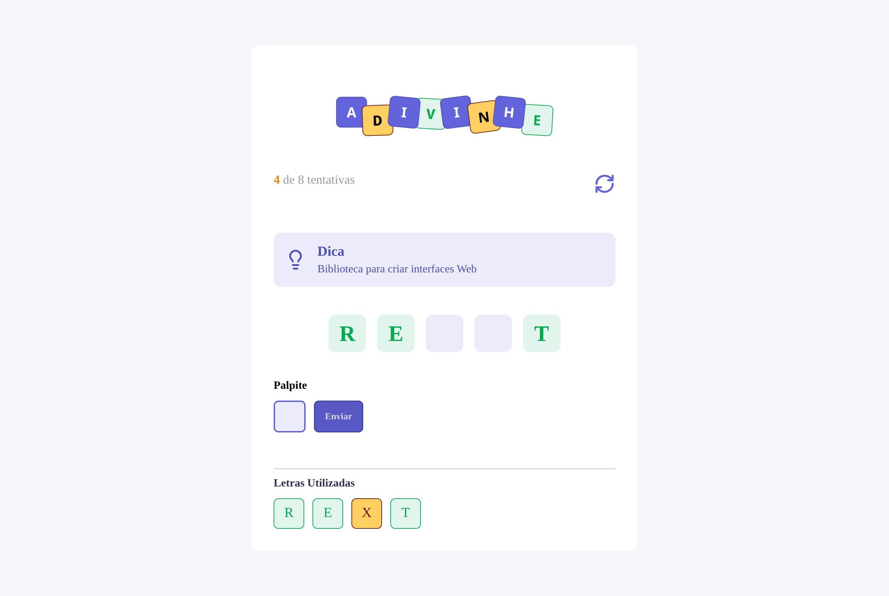

<h1 align="center">🔤 Adivinhe</h1>

<p align="center">
  Jogo de adivinhação de palavras feito com <strong>React</strong> e <strong>TypeScript</strong>.<br/>
  Leia a dica, chute as letras e descubra a palavra antes que as tentativas acabem!
</p>

<p align="center">
  
  
  
  
</p>

<p align="center">
  
</p>

---

## 🎮 Como jogar

1. Ao abrir o jogo, uma palavra é sorteada e a **dica** aparece na tela.
2. Digite **uma letra** no campo *Palpite* e clique em **Enviar**.
3. Se a letra existir na palavra, ela aparece em **verde** em todas as posições onde está.
4. Todas as letras tentadas ficam em **Letras Utilizadas**: verde para acerto, amarelo para erro.
5. Você tem **tamanho da palavra + 3** tentativas.

| Situação | Resultado |
|---|---|
| Revelou todas as letras | 🎉 **Parabéns!** e uma nova palavra é sorteada |
| Acabaram as tentativas | 😢 **Falhou :(** e o jogo recomeça |
| Letra repetida | Aviso de que a letra já foi usada (não gasta tentativa) |
| Botão 🔄 | Reinicia o jogo com outra palavra |

## 🛠️ Stack

| Tecnologia | Uso |
|---|---|
| [React 19](https://react.dev/) | Interface e componentes (`useState`, `useEffect`) |
| [TypeScript](https://www.typescriptlang.org/) | Tipagem de props, estados e dados |
| [Vite](https://vite.dev/) | Servidor de desenvolvimento e build |
| CSS Modules | Estilos isolados por componente |
| ESLint | Padronização e regras dos hooks |

## 📁 Estrutura

```
src/
├── assets/            # logo e ícones
├── components/
│   ├── Button/        # botão "Enviar"
│   ├── Header/        # logo, contador de tentativas e reiniciar
│   ├── Input/         # campo do palpite
│   ├── Letters/       # casa de uma letra (variantes de tamanho e cor)
│   ├── LettersUsed/   # lista de letras já tentadas
│   └── Tips/          # caixa da dica
├── utils/
│   └── words.ts       # palavras e dicas do jogo
├── App.tsx            # estado e regras do jogo
└── main.tsx           # ponto de entrada
```

## 🚀 Como rodar

Pré-requisito: [Node.js](https://nodejs.org/) instalado.

```bash
# clonar o repositório
git clone https://github.com/isabelasdeveloper/adivinhe.git
cd adivinhe

# instalar as dependências
npm install

# iniciar em modo desenvolvimento
npm run dev
```

Depois é só abrir o endereço que aparece no terminal (normalmente `http://localhost:5173`).

| Script | O que faz |
|---|---|
| `npm run dev` | Inicia o servidor de desenvolvimento |
| `npm run build` | Verifica os tipos e gera a versão de produção em `dist/` |
| `npm run preview` | Serve o build localmente |
| `npm run lint` | Roda o ESLint |

## ➕ Adicionando palavras

As palavras ficam em `src/utils/words.ts`. Para incluir uma nova, basta adicionar um objeto ao array:

```ts
{ id: 6, word: "VITE", tip: "Ferramenta de build para front-end" },
```

## 📚 Aprendizados

- Gerenciamento de estado com `useState` e efeitos com `useEffect`
- Tipagem de estados (`useState<Challenge | null>`) e de props
- Renderização de listas com `map` e `key`
- Classes condicionais com CSS Modules (`styles[variant]`)
- Componentes reutilizáveis estendendo props nativas (`React.ComponentProps<"input">`)

---

<p align="center">Feito com 💜 por <a href="https://github.com/isabelasdeveloper">Isabela</a></p>
